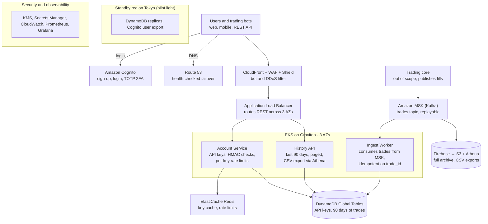

# Problem 1: Building Castle In The Cloud

This plan covers two features of a Binance-like exchange on AWS, user accounts and trade history. Both run across 3 Availability Zones in one region, with a standby region for disaster recovery.

## Scope

1. **User accounts:** sign-up, login, two-factor authentication (2FA), and API keys for trading bots.
2. **Trade history:** a user's past trades and orders, filtered by pair and date, with CSV export.

The matching engine, wallets and market data are out of scope. I treat the trading core as an existing system that publishes every trade as an event.

The three requested deliverables are sections 1–3. How each feature works, the latency budget, high availability and cost follow as supporting detail.

## Assumptions

The brief gives no hard constraints, so these are my own:

| Area | Assumption |
| --- | --- |
| Cloud | AWS; primary region Singapore (ap-southeast-1), standby Tokyo (ap-northeast-1) |
| Users | 1M registered, 50k daily active |
| Load | 500 requests/second sustained, bursts to 2,500; about 80% history reads, 20% login and API-key checks |
| Latency | p99 under 100 ms at the AWS edge for login, key checks and the first page of history |
| Data | Trades arrive on a Kafka topic from the trading core; history is kept for 7 years for audit |
| Recovery | Losing one AZ causes no downtime; losing the region is recovered in under 30 minutes |
| Team | 4–6 engineers, so managed services come before self-hosted ones |

## 1. Overview diagram

Logins go to Cognito; bots' API keys and all trade history live in DynamoDB, replicated to Tokyo. Trades flow one way, from the trading core through Kafka into DynamoDB and the S3 archive.

## How each feature works

**User accounts**

1. Sign-up and login go to Amazon Cognito. It handles passwords, email verification and TOTP 2FA, then issues a short-lived JWT (15 min) and a refresh token.
2. Services check the JWT locally against Cognito's public keys, so Cognito is not called on every request.
3. A bot creates an API key in the Account service. The secret is shown once, encrypted with KMS and stored in DynamoDB.
4. Bots sign each request with HMAC. The gateway checks the signature using a Redis cache of keys (falling back to DynamoDB), then applies per-key rate limits in Redis.

**Trade history**

1. The trading core publishes each fill to the `trades` topic in Amazon MSK (Kafka).
2. An ingest worker writes each trade to DynamoDB under the user (partition key `user_id`, sort key `timestamp#trade_id`). Writes are idempotent on `trade_id`, so replays never create duplicates.
3. The History API serves the last 90 days from DynamoDB with cursor paging. The first page is cached in Redis for 5 seconds.
4. Data Firehose copies every trade to S3 as Parquet. Older history and CSV exports run as Athena queries, and the file is delivered by a pre-signed S3 link.

## Latency budget

How a typical history or API-key request stays under the p99 100 ms target, measured from when it reaches AWS:

| Hop | Typical p99 |
| --- | --- |
| CloudFront + WAF | 5–10 ms |
| ALB | 2–5 ms |
| Service code + JWT check (done locally) | 5–10 ms |
| Redis (API-key cache, first page of history) | about 1 ms |
| DynamoDB query (one key, one page) | 10–20 ms |
| **Total** | **about 25–45 ms**, leaving room under 100 ms |

Each request makes at most one DynamoDB query with a fixed page size, and slow work such as CSV exports runs in the background. Login goes to Cognito over several round trips, so it is measured separately from the 100 ms target for our own API.

## 2. Why each service, and the alternatives considered

| Service | Role | Alternatives considered |
| --- | --- | --- |
| Route 53 | DNS, health-checked failover to the standby region | Cloudflare DNS |
| CloudFront + WAF + Shield | Blocks DDoS, credential stuffing and bots before they reach login | Cloudflare |
| Application Load Balancer | Routes REST traffic to services across 3 AZs | API Gateway (simpler, but per-request cost grows with bot traffic) |
| EKS on Graviton | Runs the Account, History API and ingest services; autoscaled with Karpenter | ECS Fargate (less to manage, less control); Lambda (cold starts hurt p99) |
| Cognito | Sign-up, login, 2FA, token issuing | Keycloak on EKS (full control, more to run); Auth0 (costly per user) |
| DynamoDB | API keys and 90 days of trade history; scales writes without sharding | Aurora PostgreSQL (needs sharding once trade rows reach billions) |
| ElastiCache for Redis | API-key cache, rate limits, first page of history | DynamoDB DAX (caches DynamoDB only, no rate-limit counters) |
| Amazon MSK | Trade events from the trading core; replay after failure | Kinesis Data Streams (simpler, shorter retention) |
| Data Firehose + S3 + Athena | Long-term history archive and CSV exports | Redshift (overkill at this size) |
| KMS, Secrets Manager | Encrypts API-key secrets and service credentials | HashiCorp Vault |
| CloudWatch, Prometheus, Grafana | Latency and error dashboards, alerts | Datadog |

### Key decisions

**DynamoDB over Aurora.** Trade history is read one way: a user's trades, newest first, a page at a time. That fits a DynamoDB key, scales writes without sharding, and Global Tables give a writable copy in Tokyo. Aurora would be the better choice if users needed free-form filters, and it would cope at today's 50k daily users.

**MSK over SQS.** Each trade feeds two readers (ingest worker and Firehose), and more will follow. Kafka lets many consumers read the same stream and replay it after a bug; SQS deletes a message once consumed. MSK is the costliest piece at this size, so MSK Serverless or Kinesis are cheaper fallbacks.

**ElastiCache over Redis in EKS.** ElastiCache fails over across AZs on its own and is patched by AWS. Redis in pods needs persistent volumes tied to one AZ, plus Sentinel or an operator. ElastiCache for Valkey is the same engine at lower cost.

**Cognito over Keycloak, Auth0 or Ory.** Cognito is cheapest at launch and needs no one to run it. Its weakness is being single-region (see High availability). Keycloak (self-hosted) or Auth0 (multi-region, costly per user) are the upgrade path.

## High availability

| Failure | What happens |
| --- | --- |
| Pod or node | Kubernetes restarts it; the ALB drains it. No user impact. |
| One AZ | Every tier runs in 3 AZs; Redis promotes a replica in under 1 minute. |
| MSK broker or ingest worker | The worker resumes from its last offset; idempotent writes prevent duplicates. |
| Whole region | Route 53 fails over to Tokyo. DynamoDB Global Tables already hold the API keys and history there, so bots and history keep working. |

**Weak spot: Cognito is regional.** Bots using API keys are unaffected, and logged-in users keep working until their 15-minute token needs a refresh. New logins fail until the user pool is restored in Tokyo from a nightly export, and password hashes cannot be exported, so users must reset their password. If that is not acceptable, Keycloak on EKS with a replicated database avoids it, at the cost of running it ourselves.

## Cost

Rough monthly estimate for the primary region (Singapore) plus the Tokyo standby, at on-demand prices. Approximate figures, as of October 2026; confirm in the AWS Pricing Calculator before committing.

Volume assumptions: 500 requests/second averaged over the month (about 1.3 billion requests), about 5 KB per response, 150k monthly active users, 5 million trades a day.

| Item | Sizing | ~USD / month |
| --- | --- | --- |
| CloudFront | 1.3B HTTPS requests, about 6.5 TB out | 2,500 |
| Cognito (Essentials tier) | 150k monthly active users, first 10k free | 2,100 |
| DynamoDB (on-demand, Global Table to Tokyo) | About 1B reads, 300M writes in each region, 450 GB per region | 850 |
| AWS WAF | 1 web ACL, about 10 rules, 1.3B requests | 800 |
| Amazon MSK | 3 × kafka.m7g.large, 300 GB storage | 600 |
| EKS worker nodes | 6 × m7g.large (Graviton) | 450 |
| ElastiCache Redis | 2 × cache.m7g.large (primary + replica) | 300 |
| Monitoring | CloudWatch, Managed Prometheus, Managed Grafana | 300 |
| NAT gateways + cross-AZ traffic | 3 NAT gateways | 250 |
| Standby region (Tokyo, pilot light) | EKS control plane + 2 small nodes | 200 |
| Firehose + S3 + Athena | About 1 TB archived in year 1 | 100 |
| EKS control plane | 1 cluster | 75 |
| Application Load Balancer | 1 ALB | 70 |
| Route 53, KMS, Secrets Manager | | 30 |
| **Total** | | **about 8,600** (range 7,000–10,000) |

Per-request services (CloudFront, WAF) and per-user Cognito are about 60% of the bill; the servers are a small share. If 500 requests/second is the peak rather than the average, those per-request lines fall in proportion.

**Ways to cut it:**

- **Skip CloudFront for API traffic.** API responses can't be cached, so attaching the WAF to the ALB and serving only the web app through CloudFront saves about USD 2,000/month, at the cost of losing edge DDoS absorption for the API.
- **Cognito Lite tier** (about USD 0.0055 per user instead of 0.015) if the Essentials features aren't needed: about USD 1,300/month.
- **Smaller instance types once real load is known.** The sizes above are a safe starting point, not a requirement. If load tests and the first weeks of metrics show low usage, step down: EKS nodes to m7g.medium, Redis to cache.t4g.medium, and MSK brokers to kafka.t3.small (or MSK Serverless at low volume). That can roughly halve the MSK, EC2 and Redis lines (about USD 1,350 today). Resize only after checking CPU, memory and p99 latency, and keep enough nodes spread across AZs to survive losing one AZ.
- **Commitments for the always-on baseline:** a 1-year Compute Savings Plan for EKS nodes and reserved ElastiCache nodes take roughly 30% off those lines.
- **Graviton and spot:** stateless pods on spot instances, with on-demand fallback.
- **Tiered storage:** DynamoDB keeps only 90 days (TTL). Older trades sit in S3 and move to Glacier after 1 year.
- **Pilot-light standby region:** only DynamoDB replicas and a minimal EKS node group run in Tokyo until failover.

## 3. Scaling plan

| When | Change |
| --- | --- |
| Over ~5k RPS | Add pods and Redis shards; DynamoDB on-demand scales by itself. Move steady DynamoDB load to provisioned capacity with autoscaling to cut cost. |
| Bots dominate traffic | A separate API-key gateway tier with its own rate limits, so bot spikes cannot slow logins. |
| Hot users (market makers with millions of trades) | Spread their DynamoDB partition by adding a suffix to the key (`user_id#month`). |
| Users in several continents | Active-active regions for history and API-key checks using Global Tables; move identity to Keycloak or a multi-region provider. |
| Regulators require data residency | A separate regional stack per licence (for example EU, APAC), with data kept in-region. |
