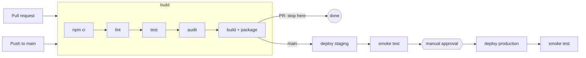

# Problem 4 – Ship It Twice

Two workflows, one per app, with the same shape:

- `.github/workflows/backend.yml`: API → EC2
- `.github/workflows/frontend.yml`: SPA → S3 + CloudFront

## Pipeline design



| Stage | Backend | Frontend |
|---|---|---|
| Build | lint, test, audit, `tar` code + prod `node_modules` | lint, test, audit, `npm run build`, stamp `version.json` |
| Deploy | upload the tarball to S3. **SSM Run Command** on instances tagged `App=backend, Env=<env>`, **one at a time**: extract to `releases/<sha>`, switch the `current` symlink, restart, check `/healthz` | `s3 sync` hashed assets (cached 1 year), then `index.html` and the rest (`no-cache`), then CloudFront invalidation |
| Verify | `curl <url>/healthz` | `curl <url>/version.json` contains the commit SHA |
| Rollback | automatic: a server whose local `/healthz` fails during the rollout switches back by itself and the rollout stops; if the public smoke test fails, every server on the new release is switched back to its `previous` symlink | automatic: the live root files (`index.html`, `version.json`…) are backed up before upload and restored if the smoke test fails |

## Assumptions

- **Repositories:** the two apps can live in separate repos. For this exercise both workflows sit in one repo, with the code under `backend/` and `frontend/`. In separate repos, each workflow moves to its own repo and drops its `paths:` filter and folder prefix.
- **Languages:**
  - **Backend:** a Node.js HTTP API (e.g. Express).
  - **Frontend:** a JavaScript SPA (e.g. React + Vite) whose `npm run build` outputs static files to `dist/`.
  - **Both:** have `package-lock.json`, `.nvmrc` and npm scripts `lint`, `test` and `build`.
- **The infrastructure already exists.** I'm not building it here:
  - **EC2:** the servers are already set up to run the API:
    - The **AWS SSM agent** is installed, so the pipeline can send them commands without SSH.
    - Each server's **instance role** lets it download the release from the S3 bucket.
    - A **systemd service** called `backend` (the Linux process manager) starts the app from `/opt/backend/current` and restarts it if it crashes.
    - `/opt/backend/current` is a **symlink** that the pipeline manages. Each release is extracted to its own folder, `/opt/backend/releases/<sha>`, and `current` points at the live one and a second symlink, `previous`, at the one before it. Deploying or rolling back just repoints the link (`ln -sfn`). Before the first deploy, `current` must not exist as a real folder.
    - Assumed unit file, `/etc/systemd/system/backend.service`:

      ```ini
      [Unit]
      Description=Backend API
      After=network-online.target
      Wants=network-online.target

      [Service]
      User=backend
      WorkingDirectory=/opt/backend/current
      EnvironmentFile=/etc/backend/backend.env
      Environment=NODE_ENV=production PORT=3000
      ExecStart=/usr/bin/node server.js
      Restart=on-failure
      RestartSec=2
      TimeoutStopSec=30

      [Install]
      WantedBy=multi-user.target
      ```

      `WorkingDirectory` is resolved through the symlink each time the service starts, so `systemctl restart backend` picks up whichever release `current` points to. Secrets such as DB credentials live in `/etc/backend/backend.env` on the server, outside the release folders, so they survive deploys.
    - The app answers `GET /healthz` on port 3000.
  - **S3 + CloudFront:** an S3 bucket behind CloudFront with SPA fallback to `index.html`.
- **The frontend calls the API on a relative path** (e.g. `/api`, routed by CloudFront). That way the build has no per-environment settings and the same build can go to staging and production.
- **GitHub settings:**
  - Two environments, `staging` and `production`. `production` has required reviewers and only `main` may deploy to it.
  - Each environment holds its own variables: `AWS_ROLE_ARN`, `ARTIFACT_BUCKET`, `TARGET_ENV`, `BACKEND_URL`, `SITE_BUCKET`, `CLOUDFRONT_DISTRIBUTION_ID`, `FRONTEND_URL`.
  - `AWS_REGION` is a repository variable.
- **AWS access:** an IAM role per environment trusts GitHub OIDC for `repo:<org>/<repo>:environment:<env>`.

## What makes it "production ready"

- **Build once, promote the same artifact.** Production gets the exact bytes that passed CI and staging.
- **Gated releases.** PRs run CI only. Staging deploys automatically on `main`. Production needs an approval and only runs after staging passed its smoke test.
- **No stored credentials.** GitHub OIDC gives the job short-lived AWS credentials. There's no SSH (SSM Run Command instead), and secrets stay on the instances.
- **Least privilege:**
  - `contents: read` by default; `id-token: write` only on deploy jobs.
  - `persist-credentials: false` on checkout.
  - Third-party actions pinned to commit SHAs.
- **Safe rollouts:**
  - The backend is updated one instance at a time and stops at the first failure.
  - Each instance keeps its previous release, so going back is a symlink switch.
  - A failed smoke test rolls the environment back automatically, and the job still fails so someone investigates.
  - Frontend hashed assets are never deleted, so open browser tabs don't break mid-deploy.
- **Serialised deploys.** Only one deploy per environment runs at a time, and it's never cancelled half-way. PR runs cancel their older runs.
- **Traceability.** Every deploy appears in the GitHub environment history with its commit SHA.

## Deliberately left out

- **Taking instances out of the load balancer during restart.** A restart may drop a few in-flight requests. If that matters, the next step is AWS CodeDeploy (load balancer-aware, alarm-based rollback).
- **Database migrations.** They need their own step and an expand/contract discipline.
- **Infrastructure as code** for the EC2, S3, CloudFront and IAM pieces assumed above.
- **E2E tests on staging, preview environments, notifications, Dependabot.** All useful, but not needed for a first production-ready version.
- **Path-filter caveat:** a workflow that a PR doesn't trigger never reports its check, so it can't be a *required* status check. If branch protection needs it, swap `paths:` for a paths-filter job.
