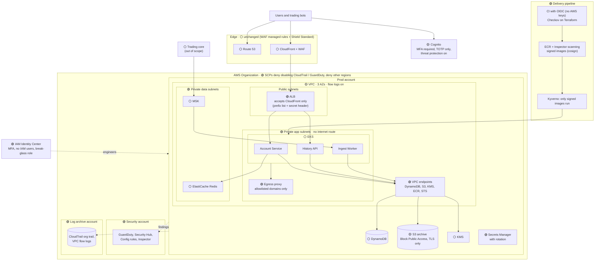

# Problem 5: Fortify The Castle

This takes the Problem 1 design (user accounts and trade history on AWS) and secures it at the infrastructure level: network, identity and access, data, accounts, detection and the delivery pipeline. Application-level controls are out of scope.

Legend used throughout: 🟢 **NEW** · 🟡 **CHANGED** · ⚪ **UNCHANGED (risk accepted)**

## 1. What I'm protecting, and from whom

| Asset | Why it matters |
| --- | --- |
| User accounts and sessions | An account takeover lets an attacker trade with the victim's funds |
| API keys | Bots hold trade rights; a leaked key is a direct path to the account |
| Trade history | Financial data and personal data under PDPA (Singapore's privacy law) |
| Audit trail | Regulators and incident response rely on it being complete and untampered |
| The AWS estate itself | Whoever controls the cloud account controls everything above |

| Threat | Most likely path in |
| --- | --- |
| Credential stuffing and bots | Leaked password lists replayed against `/login` |
| DDoS and extortion | Exchanges are routine targets, especially during market volatility |
| A compromised pod or service | A vulnerable dependency, then moving sideways inside the VPC |
| Stolen engineer credentials | Phishing an engineer with console or kubectl access |
| Insider abuse | An engineer reading trade data or disabling logging |
| Supply chain | A poisoned image or a CI pipeline with long-lived AWS keys |

## 2. Updated architecture

The shape of the system is unchanged from Problem 1; the changes are around it. Services and data move into private subnets, outbound traffic is controlled, engineers and pipelines get no long-lived credentials, and logs leave the production account where nobody in it can delete them.

## 3. Changes, and what each protects against

Priority: **P0** = refuse to ship without · **P1** = within 90 days of launch · **P2** = deferred.

### Identity configuration

| | Change | Protects against | Priority |
| --- | --- | --- | --- |
| 🟡 | Cognito: MFA required for every user; TOTP only, SMS disabled | Password reuse, SIM-swap attacks | P0 |
| 🟡 | Cognito threat protection (compromised-credential checks, adaptive risk) | Logins with leaked passwords or from risky contexts | P0 |
| 🟡 | Short token lifetimes (15 min access token, 12 h refresh token) | Stolen tokens staying useful for long | P0 |

### Network

| | Change | Protects against | Priority |
| --- | --- | --- | --- |
| 🟢 | Three subnet tiers: public (ALB only), private app (EKS), private data (Redis, MSK); no route to the internet from app or data tiers | Direct access to services and data | P0 |
| 🟢 | VPC endpoints for DynamoDB, S3, KMS, ECR and STS, with endpoint policies limited to this account's resources | Data leaving through the internet; access to other accounts' buckets | P0 |
| 🟢 | Outbound traffic only through an egress proxy with a domain allowlist | A compromised pod calling home or sending data out | P1 |
| 🟢 | Security groups per tier; Kubernetes NetworkPolicies that deny all pod traffic by default | A compromised pod reaching every other service | P0 |
| 🟢 | ALB only accepts traffic from CloudFront: security group limited to the CloudFront managed prefix list, plus a secret origin header checked by an ALB listener rule | Attackers calling the ALB directly and going around the WAF | P0 |
| 🟢 | VPC flow logs to the log archive account | No record of network traffic during an incident | P0 |

### Data and secrets

| | Change | Protects against | Priority |
| --- | --- | --- | --- |
| 🟢 | S3 Block Public Access at account level; bucket policies require TLS | Accidentally public buckets | P0 |
| 🟢 | Secrets Manager for all service credentials, with automatic rotation; nothing in images or environment files | Leaked credentials in repos or images | P0 |

### Accounts and human access

| | Change | Protects against | Priority |
| --- | --- | --- | --- |
| 🟢 | AWS Organizations with separate prod, staging, security and log-archive accounts | Blast radius; staging mistakes reaching prod | P0 |
| 🟢 | Service control policies: deny disabling CloudTrail, GuardDuty or Config; deny regions other than Singapore and Tokyo; deny leaving the organization | Attackers covering their tracks; resources in unwatched regions | P0 |
| 🟢 | IAM Identity Center with MFA; no IAM users or access keys; read-only by default, prod write access only through a time-limited, approved role | Phished engineers, standing admin access | P0 |
| 🟢 | Break-glass role with hardware MFA, alerting on every use | Losing access during an incident, without leaving a silent back door | P0 |

### Detection and response

| | Change | Protects against | Priority |
| --- | --- | --- | --- |
| 🟢 | Organization CloudTrail (including DynamoDB and S3 data events for sensitive tables) into the log archive account | Missing or erased audit evidence | P0 |
| 🟢 | GuardDuty in all accounts, delegated to the security account | Compromised credentials, unusual API calls | P0 |
| 🟢 | Security Hub and AWS Config rules (no public buckets, MFA on root) | Configuration drifting back to insecure | P1 |
| 🟢 | Alerts on high-severity findings to the on-call channel; runbooks for key leaks, account takeover waves and DDoS | Slow response | P1 |

### Delivery pipeline

| | Change | Protects against | Priority |
| --- | --- | --- | --- |
| 🟢 | CI assumes AWS roles through OIDC; no long-lived AWS keys anywhere | Stolen CI secrets giving permanent access | P0 |
| 🟢 | Checkov on every Terraform plan; prod changes need review | Insecure infrastructure merged by mistake | P0 |
| 🟢 | ECR scanning with Inspector; builds fail on critical CVEs | Shipping known-vulnerable images | P0 |
| 🟢 | Images signed with cosign; Kyverno only admits signed images from our ECR | Poisoned or unknown images running in prod | P1 |

## 4. Priorities

**Refuse to ship without (P0).** Everything that keeps services off the internet and the logs intact: mandatory MFA, ALB locked to CloudFront, private subnets with VPC endpoints, no public buckets, secrets in Secrets Manager, separate accounts with SCPs, no long-lived credentials, CloudTrail and GuardDuty. These are cheap at launch and very expensive to retrofit.

**First 90 days (P1).** Egress proxy, image signing, Security Hub and Config, incident runbooks, and an external penetration test before opening to the public.

**Deferred (P2), with the reason:**

- **Per-service IAM roles and cluster hardening** (EKS Pod Identity, private EKS API endpoint, Pod Security Standards, GuardDuty runtime monitoring). NetworkPolicies and security groups already limit lateral movement with three services. First to add as the service count grows.
- **Kafka authentication and topic ACLs.** MSK sits in a private data subnet reachable only from the app tier, and encrypts traffic with TLS by default. Add IAM auth and ACLs when a second team or producer connects.
- **Service mesh with mTLS between pods.** Revisit at around 10 services or when compliance requires it.
- **A full SIEM.** Security Hub and GuardDuty cover a small team. Add one when there is a security team to work it.
- **Passkeys (WebAuthn) as an MFA option.** Stronger than TOTP against phishing, but it needs user-pool and client changes.

## 5. Risks accepted as they stand

| | Decision | Why it's acceptable |
| --- | --- | --- |
| ⚪ | Edge stays as in Problem 1: no Shield Advanced, no Bot Control or account-takeover rule groups | Shield Advanced costs about USD 3,000/month plus data fees, too much at launch. Shield Standard (free) handles common network floods, and WAF managed rule groups plus a per-IP rate-based rule on `/login` cost only a few dollars a month and cover basic attacks. Revisit after the first serious DDoS or bot wave. |
| ⚪ | Default encryption at rest (AWS-owned keys) for DynamoDB, S3, MSK and Redis instead of a customer key per store | Data is still encrypted on disk. Separate keys add control over who can decrypt, but also cost and key-policy work. |
| ⚪ | No S3 Object Lock or extra backups beyond Problem 1 | CloudTrail logs already sit in a separate account the prod team can't change, which covers the main tampering risk. |
| ⚪ | Cognito stays single-region | This is an availability risk, already covered in Problem 1, not a confidentiality one |
| ⚪ | The trading core is trusted as a producer | It's out of scope and its own security needs a separate review |
| ⚪ | Route 53 unchanged | DNSSEC adds operational risk for little gain at this stage |

## 6. Facts I don't have

| Missing fact | How I'd get it | What I assumed |
| --- | --- | --- |
| Which licence and regulator apply | Ask compliance and legal | MAS licence in Singapore, so MAS Technology Risk Management guidelines and PDPA apply |
| Data classification for trade history | A session with legal and the data owner | Confidential personal and financial data, kept 7 years |
| The trading core's security posture | Review its design and access paths with its team | Trusted; MSK is reachable only from inside the VPC |
| Past incidents and current threats | Incident history, the WAF and GuardDuty data from the first weeks, threat-intel feeds | Credential stuffing and DDoS are the top two threats |
| Security budget and team size | Ask engineering leadership | No dedicated security team; managed AWS services over self-run tools |
